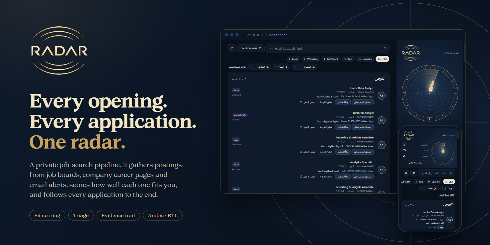
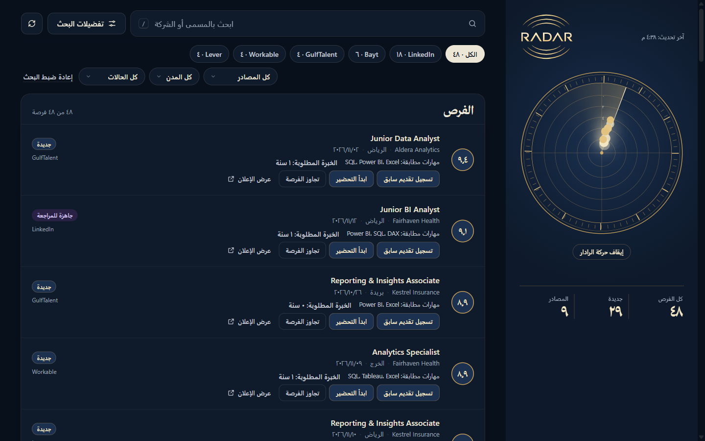
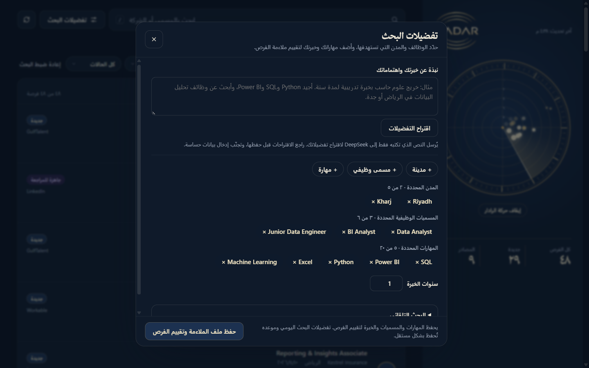
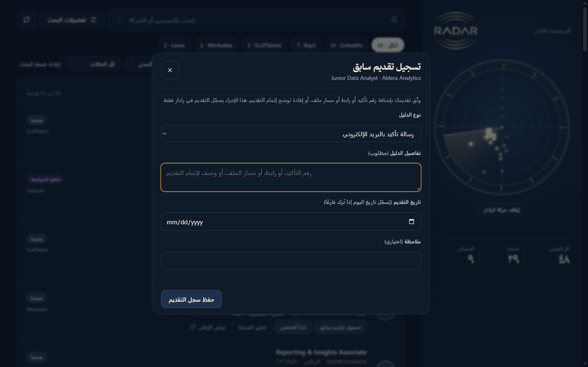
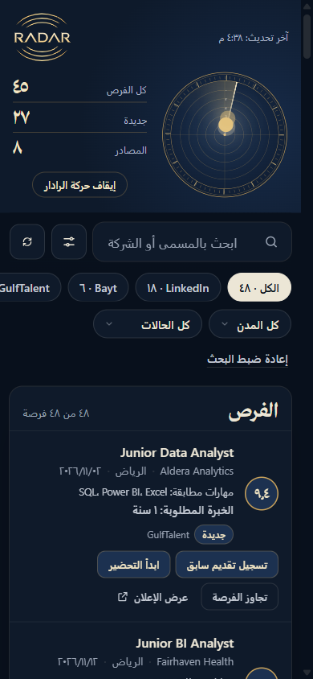

  

  <b>A private job-search pipeline that finds postings, scores how well they fit you, and follows every application to the end.</b>

  Arabic-first · Right-to-left · Dark · Runs on your own machine

---

## Why Radar

Job hunting is scattered. Openings appear on LinkedIn, on company career pages, in recruiter emails and on regional boards, and the same posting shows up in three places. It is easy to miss a good one, apply twice, or lose track of where an application stands.

Radar brings all of it into one dashboard, keeps a single copy of each posting, tells you **how well it fits and why**, and records what happened to every application.

## The dashboard

  

Every stored posting is a point on the radar. Closer to the centre means a better fit. A sweep passes over the plate and lights each point in turn, so the whole pipeline can be read at a glance. The list beside it is where you search, filter and act.

## What it does

### Finds postings from many places

- **LinkedIn public job pages**, searched on demand or at a time you choose each day.
- **Company career boards** that publish open APIs (Greenhouse, Lever, SmartRecruiters, Workable, Ashby).
- **Job-alert emails** from Indeed, Bayt, GulfTalent and others, read from your own inbox.

Each posting is stored once, however many sources it came from.

### Scores the fit, and shows its reasons

Every posting gets a score from 0 to 10, built from three things: how many of your skills it asks for, how close the work is to what you want, and whether it suits your level. Next to the score you see the reasons:

- the skills you **have** that it asks for,
- the skills you **lack**,
- the years of experience it requires.

Nothing is a black box, and a score you set yourself is never overwritten.

### Lets you describe your experience in plain words

  

Write a sentence or two about your background and the roles you want. A language model suggests the cities, job titles and skills for your search preferences. You review and edit them before anything is saved. Only the text you type is sent, and nothing is stored until you approve it.

### Follows every application, with evidence

Each opportunity moves through a fixed set of statuses: new, preparing, ready for review, submitted, interview, offer, with skipped, withdrawn and rejected as ways out. Moves that make no sense are not allowed.

  

An application cannot be marked as submitted without proof. You attach a confirmation email, a link, a screenshot path or a note, and the date. The record stays attached to the opportunity, so you can always answer "did I apply, and how do I know?".

### Works the same on a phone

  

The dashboard is built for phone and desktop equally. The radar, the filters and every action are there on a small screen.

## Private by design

- Everything runs on your own computer. The dashboard is reachable only from that machine.
- No account on any job board is ever used or touched.
- Your data stays in your own database.

## Built with

PostgreSQL, FastAPI and n8n, packaged with Docker. The interface is a single static page with no build step.

---

The screenshots use invented postings and invented employers. Source code is not published here.
